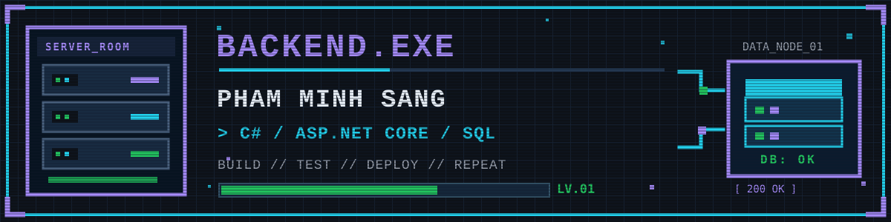

<!--
  GitHub Profile README — PiupiuTenshi
  Theme: 2D Pixel / Retro Arcade, remixed for Backend .NET Development

  Setup:
  1. Copy README.md to the root of github.com/PiupiuTenshi/PiupiuTenshi.
  2. Copy assets/pixel-banner.svg to assets/pixel-banner.svg in that repository.
  3. Keep your existing .github/workflows/snake.yml if it already works.
  4. Commit the changes to the default branch.

  Third-party stat cards may occasionally fail because of provider rate limits.
  If you self-host streak stats, replace streak-stats.demolab.com below with your domain.
-->

<div align="center">



<a href="https://github.com/PiupiuTenshi">
  
</a>

<h3>👨‍💻 Phạm Minh Sáng — Backend .NET Developer (Intern) 🇻🇳</h3>

<a href="https://github.com/PiupiuTenshi?tab=repositories">
  
</a>

<br/><br/>


<a href="https://github.com/PiupiuTenshi?tab=followers">
  
</a>


<br/><br/>

<samp>LV.1 BACKEND INTERN &nbsp; <code>████████████░░░░░░░░</code> &nbsp; 60% → JUNIOR</samp>

</div>

<div align="center">▰▰▰▰▰▰▰▰▰▰▰▰▰▰▰ ◈ ▰▰▰▰▰▰▰▰▰▰▰▰▰▰▰</div>

## 👾 whoami


```csharp
var sang = new BackendDeveloper
{
    Name = "Phạm Minh Sáng",
    Alias = "PiupiuTenshi",
    Role = "Backend .NET Developer (Intern)",
    Location = "Vietnam 🇻🇳",
    MainStack = ["C#", "ASP.NET Core", "EF Core", "SQL"],
    InterestedIn = ["REST APIs", "Real-time", "Docker", "System Design"],
    SideQuests = ["AI / Automation", "Pixel Games"],
    CurrentQuest = "Write clean code. Build reliable services. Keep learning."
};
```

> ⚙️ Mình tập trung vào **Backend Development với C# / ASP.NET Core** — thiết kế API, xử lý nghiệp vụ và làm việc với cơ sở dữ liệu.
>
> 🗄️ Quan tâm đến **Database, Authentication, Realtime và Deployment** để xây dựng hệ thống thực tế.
>
> 🚀 Mục tiêu: phát triển từ intern lên backend developer vững kiến thức, code rõ ràng và triển khai được sản phẩm chạy thật.

<br clear="right"/>

<div align="center">▰▰▰▰▰▰▰▰▰▰▰▰▰▰▰ ◈ ▰▰▰▰▰▰▰▰▰▰▰▰▰▰</div>

## 🎒 Inventory — Tech Stack

<div align="center">

**`⚔️ MAIN WEAPONS // BACKEND`**


<br/>


<br/><br/>

**`💾 DATA STORAGE // DATABASES`**


<br/><br/>

**`🛠️ DEPLOYMENT // TOOLS`**


<br/><br/>

**`🧪 SIDE QUESTS // OTHER LANGUAGES`**


</div>

<div align="center">▰▰▰▰▰▰▰▰▰▰▰▰▰▰▰ ◈ ▰▰▰▰▰▰▰▰▰▰▰▰▰▰▰</div>

## 🧩 Main Quests — What I Build

<table>
  <tr>
    <td width="33%" valign="top" align="center">
      <h3>⚙️ API &amp; BUSINESS LOGIC</h3>
      RESTful endpoints<br/>
      Validation &amp; DTOs<br/>
      Authentication &amp; authorization
    </td>
    <td width="33%" valign="top" align="center">
      <h3>🗄️ DATA &amp; REALTIME</h3>
      SQL &amp; data modeling<br/>
      EF Core / LINQ<br/>
      SignalR &amp; async workflows
    </td>
    <td width="33%" valign="top" align="center">
      <h3>🚀 SHIP &amp; OPERATE</h3>
      Docker &amp; Compose<br/>
      Linux / VPS deployment<br/>
      Testing, logs &amp; reliability
    </td>
  </tr>
</table>

<div align="center">▰▰▰▰▰▰▰▰▰▰▰▰▰ ◈ ▰▰▰▰▰▰▰▰▰▰▰▰▰▰</div>

## 📊 Character Stats

<div align="center">


<!-- If this card is rate-limited, self-host github-readme-streak-stats and update the domain. -->


<br/><br/>


</div>

<div align="center">▰▰▰▰▰▰▰▰▰▰▰▰▰▰▰ ◈ ▰▰▰▰▰▰▰▰▰▰▰▰▰▰</div>

## 🗺️ Quest Log — Currently Leveling Up

<table>
  <tr>
    <td width="50%" valign="top">
      <b>⚔️ BACKEND / .NET</b>
      <ul>
        <li>✅ REST API &amp; CRUD</li>
        <li>✅ C# / LINQ / async-await</li>
        <li>✅ EF Core &amp; database queries</li>
        <li>✅ JWT &amp; role-based access fundamentals</li>
        <li>⬜ Unit &amp; integration testing</li>
        <li>⬜ Caching &amp; background jobs</li>
        <li>⬜ Message queues &amp; event-driven systems</li>
        <li>⬜ Advanced system design</li>
      </ul>
    </td>
    <td width="50%" valign="top">
      <b>🧠 ENGINEERING / DEVOPS</b>
      <ul>
        <li>✅ Git workflow &amp; API documentation</li>
        <li>✅ Docker / Docker Compose basics</li>
        <li>✅ Linux VPS deployment basics</li>
        <li>✅ API authentication &amp; role testing</li>
        <li>⬜ CI/CD pipelines</li>
        <li>⬜ Monitoring &amp; observability</li>
        <li>⬜ Security hardening</li>
        <li>⬜ Performance &amp; load testing</li>
      </ul>
    </td>
  </tr>
</table>

<div align="center">▰▰▰▰▰▰▰▰▰▰▰▰▰ ◈ ▰▰▰▰▰▰▰▰▰▰▰▰▰</div>

## 🐍 Contribution Snake & Dev Quote

<div align="center">

<!-- Requires the existing snake GitHub Actions workflow to publish this SVG to the output branch. -->


<br/><br/>


</div>

<div align="center">▰▰▰▰▰▰▰▰▰▰▰▰▰▰▰ ◈ ▰▰▰▰▰▰▰▰▰▰▰▰▰▰</div>

## 🤝 Connect — Continue?

<div align="center">

<a href="https://github.com/PiupiuTenshi?tab=repositories">
  
</a>
<a href="https://github.com/PiupiuTenshi">
  
</a>
<a href="https://cursed-biomes-portfolio.italone1207.workers.dev/">
  
</a>

<br/><br/>

<samp>⌨ STATUS: ONLINE &nbsp;|&nbsp; NEXT QUEST: BUILD • TEST • DEPLOY 🪙</samp>


</div>
